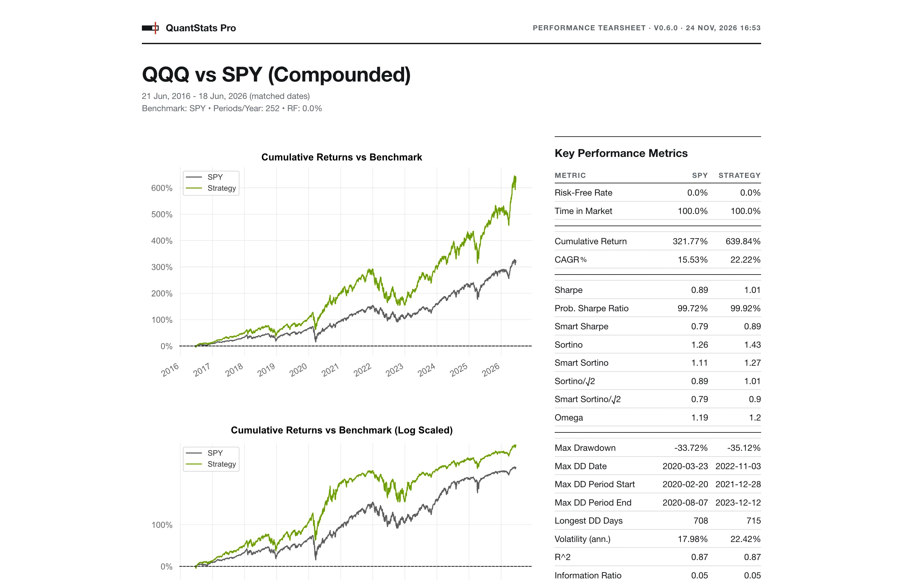

[](https://pypi.org/project/quantstats-pro/)
[](https://pypi.org/project/quantstats-pro/)
[](https://github.com/diegoalvarezmgl/quantstats-pro/actions/workflows/ci.yml)
[](LICENSE.txt)

# QuantStats Pro: Portfolio analytics for quants

**QuantStats Pro** is an enhanced, actively maintained **drop-in replacement** for [QuantStats](https://github.com/ranaroussi/quantstats) by Ran Aroussi. It performs portfolio profiling, allowing quants and portfolio managers to understand their performance with in-depth analytics and risk metrics.

```bash
pip install quantstats-pro   # replaces: pip install quantstats
```

```python
import quantstats as qs       # import unchanged
```

> **Note:** QuantStats Pro **cannot coexist** with the original `quantstats`
> package in the same environment — both provide the `quantstats` import
> namespace. Uninstall `quantstats` before installing `quantstats-pro`
> (`pip uninstall quantstats`).

[Changelog »](./CHANGELOG.md) · [Upstream »](https://github.com/ranaroussi/quantstats) · [Contributing »](./CONTRIBUTING.md)

### Why QuantStats Pro?

This fork fixes known bugs, improves reliability, and evolves reports and visualizations — while keeping the same `import quantstats as qs` API.

**What's new in Pro (beyond upstream):**

- **`quantstats.montecarlo`** — multi-model Monte Carlo engine (GBM, GARCH, Heston, bootstraps, Bayesian, …) with cross-model analytics and an institutional HTML tearsheet
- **`quantstats.alphadecay`** — rolling-window alpha-decay monitor with z-score traffic lights, CUSUM, and time-underwater diagnostics
- **New HTML tearsheets** — `html_simple`, `html_montecarlo`, `html_alpha_decay` (plus the classic full `html` report)
- **Visual redesign** — updated branding and chart palette on the classic tearsheet (v0.2.0+)

### Package modules

| Module | Purpose |
|--------|---------|
| `quantstats.stats` | 50+ performance metrics (Sharpe, Sortino, drawdown, VaR, …) |
| `quantstats.plots` | Performance visualizations (returns, drawdown, heatmaps, rolling stats, …) |
| `quantstats.reports` | HTML tearsheets and metrics tables |
| `quantstats.montecarlo` | Multi-model forward simulation engine and analytics |
| `quantstats.alphadecay` | Short-horizon rolling risk analysis and decay detection |
| `quantstats.utils` | Data prep, `download_returns`, pandas helpers |

Legacy shuffle-based Monte Carlo remains at `qs.stats.montecarlo()` for backward compatibility. The new engine lives under `quantstats.montecarlo` and powers `qs.reports.html_montecarlo()`.

### Crypto and 24/7 markets

For daily crypto data, pass `periods_per_year=365` to reports and stats that annualize:

```python
import quantstats as qs

qs.extend_pandas()
returns = qs.utils.download_returns("BTC-USD")

# Tearsheet with 365 trading days per year
qs.reports.html(returns, periods_per_year=365, output="btc_report.html")

# Individual metrics
qs.stats.sharpe(returns, periods=365)
qs.stats.rar(returns, periods=365)
```

qs.stats.rar(returns, periods=365)
```

---

## HTML Tearsheets

QuantStats Pro ships **four** HTML report types. All open in the browser by default, or save to disk with `output="path.html"`.

| Function | Use case |
|----------|----------|
| `qs.reports.html(...)` | Full classic tearsheet (metrics + all charts) |
| `qs.reports.html_simple(...)` | Lean equity-curve tearsheet — core metrics and charts only |
| `qs.reports.html_montecarlo(...)` | Multi-model Monte Carlo risk analysis (1y forward horizon by default) |
| `qs.reports.html_alpha_decay(...)` | Short-window alpha-decay health monitor (7/15/30d) |

```python
import quantstats as qs

returns = qs.utils.download_returns("QQQ")

# Classic full report vs benchmark
qs.reports.html(returns, benchmark="SPY", output="qqq_full.html")

# Simplified equity-curve view
qs.reports.html_simple(returns, benchmark="SPY", output="qqq_simple.html")

# Multi-model Monte Carlo (median consensus + stress envelope)
qs.reports.html_montecarlo(
    returns,
    bust=-0.25,   # P(Bust): drawdown threshold
    goal=0.50,    # P(Goal): terminal return target
    sims=500,
    seed=42,
    output="qqq_montecarlo.html",
)

# Alpha decay monitor
qs.reports.html_alpha_decay(
    returns,
    windows=(7, 15, 30),
    output="qqq_alpha_decay.html",
)
```

[View sample classic tearsheet](./docs/tearsheet.html) · [Monte Carlo docs](./docs/montecarlo.md)

---

## Monte Carlo Engine

`quantstats.montecarlo` characterises an asset with several stochastic models, simulates forward paths from each, and compares the distribution of outcomes (CAGR, max drawdown, bust/goal probabilities, CVaR).

### Built-in models

| Model | Name | Category |
|-------|------|----------|
| GBM | `gbm` | Monte Carlo |
| Shuffle (legacy) | `shuffle` | Monte Carlo |
| Bootstrap | `bootstrap` | Monte Carlo |
| Block Bootstrap | `block_bootstrap` | Monte Carlo |
| Jump Diffusion (Merton) | `jump_diffusion` | Monte Carlo |
| GARCH(1,1)-t | `garch` | Monte Carlo |
| Heston (SV) | `heston` | Monte Carlo |
| Bayesian (NIG) | `bayesian` | Monte Carlo |
| Bayesian Bootstrap | `bayesian_bootstrap` | Monte Carlo |
| Trimmed Bootstrap (top 1%) | `trimmed_1pct` | Stress |

### Programmatic API

```python
from quantstats.montecarlo import run_models, available_models
from quantstats.montecarlo import analytics as mca

print(available_models())
# ['bayesian', 'bayesian_bootstrap', 'block_bootstrap', 'bootstrap', ...]

results = run_models(
    returns,
    models=["gbm", "garch", "bootstrap"],
    horizon=252,      # 1 year (default: periods_per_year)
    sims=1000,
    bust=-0.25,
    goal=0.50,
    seed=42,
)

# Per-model summary row
gbm = results["gbm"]
print(gbm.summary)          # cagr_p5, cagr_median, maxdd_p95, prob_loss, cvar_5, …
print(gbm.sim_returns.shape)  # (horizon, sims)

# Cross-model consensus and stress envelope
median = mca.model_median_summary(results)
envelope = mca.conservative_envelope(results)
hist = mca.historical_summary(returns, horizon=252)
```

### Legacy shuffle Monte Carlo

The original upstream API still works — random permutation of historical returns:

```python
mc = qs.stats.montecarlo(returns, sims=1000, bust=-0.20, goal=0.50, seed=42)
print(f"Bust probability: {mc.bust_probability:.1%}")
print(f"Goal probability: {mc.goal_probability:.1%}")
mc.plot()
```

[Full Monte Carlo documentation »](./docs/montecarlo.md)

---

## Alpha Decay Monitor

`quantstats.alphadecay` tracks whether a strategy's short-term risk profile is drifting from its historical norm. It computes **10 rolling metrics** over configurable windows (default 7/15/30 days):

CAGR · Volatility · Downside Vol · Max Drawdown · Mean Drawdown · Win Rate · VaR 95% · Expected Shortfall 95% · Payoff Ratio · Skew

Each metric-window cell gets a **traffic-light status** (Excellent / Good / Warning / Critical) based on z-scores computed on a per-metric analysis scale (log transforms for skewed metrics). The tearsheet also includes:

- **Health score** — count of Good/Excellent cells
- **CUSUM** return-decay detector
- **Time underwater** duration analysis
- Per-metric distribution charts with current observation vs historical mean

### Programmatic API

```python
from quantstats.alphadecay import analyze, available_metrics

print(available_metrics())
# ['cagr', 'volatility', 'downside_vol', 'max_drawdown', ...]

result = analyze(
    returns,
    windows=(7, 15, 30),
    rf=0.0,
    periods=252,
)

print(f"Health: {result.score}/{result.total} ({result.score_pct:.0f}%)")

for metric in result.metrics:
    wr = metric.windows[30]  # latest 30-day window
    print(f"{metric.spec.label}: z={wr.z_score:+.2f} → {wr.status}")
```

Generate the full HTML tearsheet with `qs.reports.html_alpha_decay(returns)`.

[Alpha Decay documentation »](./docs/alphadecay.md)

---

## Quick Start

```python
%matplotlib inline
import quantstats as qs

# extend pandas functionality with metrics, etc.
qs.extend_pandas()

# fetch the daily returns for a stock
stock = qs.utils.download_returns('META')

# show sharpe ratio
qs.stats.sharpe(stock)

# or using extend_pandas() :)
stock.sharpe()
```

Output:

```
0.7604779884378278
```

### Visualize stock performance

```python
qs.plots.snapshot(stock, title='Facebook Performance', show=True)

# can also be called via:
# stock.plot_snapshot(title='Facebook Performance', show=True)
```

Output:


### Creating a report

The classic full tearsheet compares a strategy against an optional benchmark:

```python
# benchmark can be a pandas Series or ticker
qs.reports.html(stock, "SPY", output="meta_report.html")
```

Output will generate something like this:



See [HTML Tearsheets](#html-tearsheets) above for `html_simple`, `html_montecarlo`, and `html_alpha_decay`.

### Available methods

To view a complete list of available methods, run:

```python
[f for f in dir(qs.stats) if f[0] != '_']
```

```python
['avg_loss',
 'avg_return',
 'avg_win',
 'best',
 'cagr',
 'calmar',
 'common_sense_ratio',
 'comp',
 'compare',
 'compsum',
 'conditional_value_at_risk',
 'consecutive_losses',
 'consecutive_wins',
 'cpc_index',
 'cvar',
 'drawdown_details',
 'expected_return',
 'expected_shortfall',
 'exposure',
 'gain_to_pain_ratio',
 'geometric_mean',
 'ghpr',
 'greeks',
 'implied_volatility',
 'information_ratio',
 'kelly_criterion',
 'kurtosis',
 'max_drawdown',
 'monthly_returns',
 'montecarlo',
 'montecarlo_cagr',
 'montecarlo_drawdown',
 'montecarlo_sharpe',
 'outlier_loss_ratio',
 'outlier_win_ratio',
 'outliers',
 'payoff_ratio',
 'profit_factor',
 'profit_ratio',
 'r2',
 'r_squared',
 'rar',
 'recovery_factor',
 'remove_outliers',
 'risk_of_ruin',
 'risk_return_ratio',
 'rolling_greeks',
 'ror',
 'sharpe',
 'skew',
 'sortino',
 'adjusted_sortino',
 'tail_ratio',
 'to_drawdown_series',
 'ulcer_index',
 'ulcer_performance_index',
 'upi',
 'value_at_risk',
 'var',
 'volatility',
 'win_loss_ratio',
 'win_rate',
 'worst']
```

```python
[f for f in dir(qs.plots) if f[0] != '_']
```

```python
['daily_returns',
 'distribution',
 'drawdown',
 'drawdowns_periods',
 'earnings',
 'histogram',
 'log_returns',
 'monthly_heatmap',
 'montecarlo',
 'montecarlo_distribution',
 'returns',
 'rolling_beta',
 'rolling_sharpe',
 'rolling_sortino',
 'rolling_volatility',
 'snapshot',
 'yearly_returns']
```

See [Monte Carlo documentation](./docs/montecarlo.md) and `help(qs.stats.<method>)` for parameter details.

Console / notebook helpers:

```python
qs.reports.metrics(returns, mode="full")   # metrics table
qs.reports.plots(returns, mode="full")     # all plots
qs.reports.basic(returns)                  # basic metrics + plots
qs.reports.full(returns)                   # full metrics + plots
```

### Important: Period-Based vs Trade-Based Metrics

QuantStats analyzes **return series** (daily, weekly, monthly returns), not discrete trade data. This means:

- **Win Rate** = percentage of periods with positive returns
- **Consecutive Wins/Losses** = consecutive positive/negative return periods
- **Payoff Ratio** = average winning period return / average losing period return
- **Profit Factor** = sum of positive returns / sum of negative returns

These metrics are **valid and useful** for:
- Systematic/algorithmic strategies with regular rebalancing
- Analyzing return-series behavior over time
- Comparing strategies on a period-by-period basis

For **discretionary traders** with multi-day trades, these period-based metrics may differ from trade-level statistics. A single 5-day trade might span 3 positive days and 2 negative days - QuantStats would count these as 3 "wins" and 2 "losses" at the daily level.

This is consistent with how all return-based analytics work (Sharpe ratio, Sortino ratio, drawdown analysis, etc.) - they operate on return periods, not discrete trade entries/exits.

---

In the meantime, you can get insights as to optional parameters for each method, by using Python's `help` method:

```python
help(qs.stats.conditional_value_at_risk)
```

```
Help on function conditional_value_at_risk in module quantstats.stats:

conditional_value_at_risk(returns, sigma=1, confidence=0.99)
    calculates the conditional daily value-at-risk (aka expected shortfall)
    quantifies the amount of tail risk an investment
```

## Installation

Install using `pip`:

```bash
pip install quantstats-pro --upgrade
```

## Requirements

* [Python](https://www.python.org) >= 3.10
* [pandas](https://github.com/pydata/pandas) >= 1.5.0
* [numpy](http://www.numpy.org) >= 1.24.0
* [scipy](https://www.scipy.org) >= 1.11.0
* [matplotlib](https://matplotlib.org) >= 3.7.0
* [seaborn](https://seaborn.pydata.org) >= 0.13.0
* [tabulate](https://bitbucket.org/astanin/python-tabulate) >= 0.9.0
* [yfinance](https://github.com/ranaroussi/yfinance) >= 0.2.40
* [arch](https://github.com/bashtage/arch) >= 6.0 (GARCH calibration for Monte Carlo)
* [plotly](https://plot.ly/) >= 5.0.0 (optional, for using `plots.to_plotly()`)

## Questions?

If you find a bug, please [open an issue](https://github.com/diegoalvarezmgl/quantstats-pro/issues).

Contributions welcome — check [open issues](https://github.com/diegoalvarezmgl/quantstats-pro/issues) or upstream [QuantStats issues](https://github.com/ranaroussi/quantstats/issues) for bugs we're tracking.

## Known Issues

For some reason, I couldn't find a way to tell seaborn not to return the
monthly returns heatmap when instructed to save - so even if you save the plot (by passing `savefig={...}`) it will still show the plot.

## Legal Stuff

**QuantStats Pro** is a fork of **QuantStats** by Ran Aroussi, distributed under the **Apache Software License**. See [LICENSE.txt](./LICENSE.txt) for details.

## Credits

**QuantStats Pro** — maintained by [Diego Alvarez](https://github.com/diegoalvarezmgl)

**QuantStats** (original) — [Ran Aroussi](https://github.com/ranaroussi)
