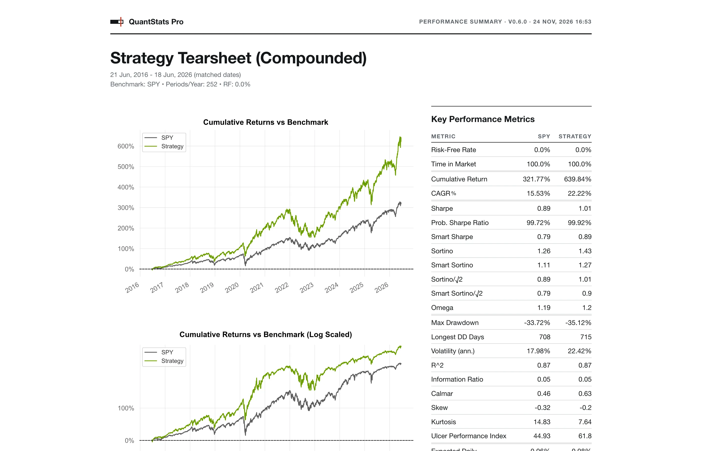
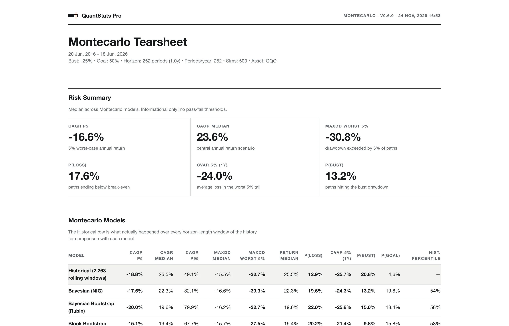
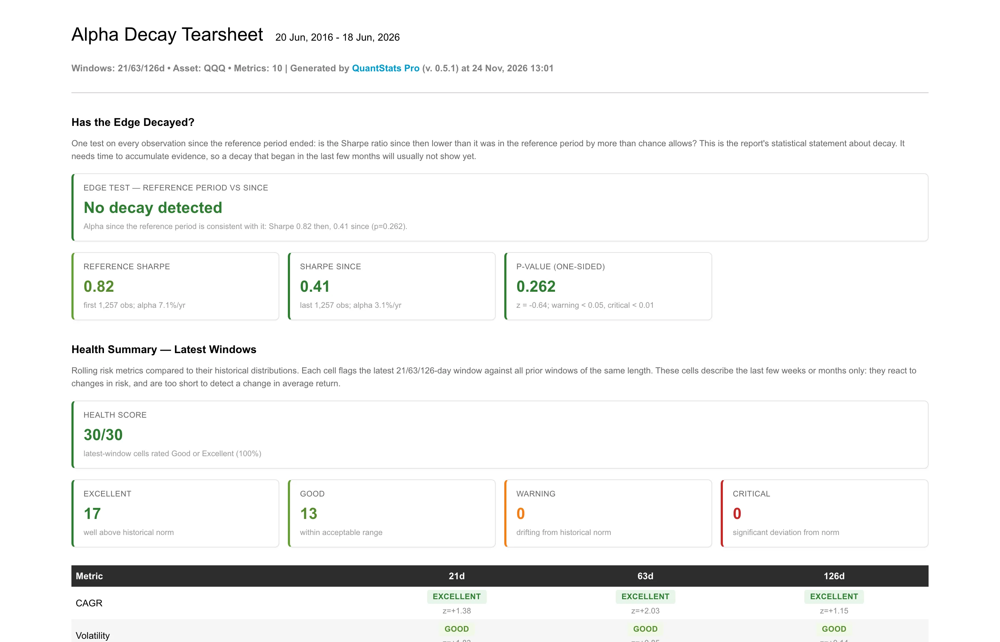

[](https://pypi.org/project/quantstats-pro/)
[](https://pypi.org/project/quantstats-pro/)
[](https://github.com/diegoalvarezmgl/quantstats-pro/actions/workflows/ci.yml)
[](https://github.com/diegoalvarezmgl/quantstats-pro/blob/main/LICENSE.txt)

# QuantStats Pro: Advanced portfolio analytics for quants

**QuantStats Pro** is an actively maintained **drop-in replacement** for [QuantStats](https://github.com/ranaroussi/quantstats) — same `import quantstats as qs`, hardened metrics, and a product roadmap that goes well beyond the original scope.   
  
Where original quantstats stops at classic performance stats and a single HTML tearsheet, Pro is built to become a **definitive quantitative analytics stack**: advanced risk engines, new metrics, institutional-grade reports, and outputs designed to drive **actionable decisions**, not just describe the past.

Built for systematic traders, portfolio managers, and quant researchers who need production-grade tearsheets from a returns series.

```bash
pip install quantstats-pro
```

```python
import quantstats as qs
```

> **Note:** QuantStats Pro **cannot coexist** with the original `quantstats`
> package in the same environment — both provide the `quantstats` import
> namespace. Uninstall `quantstats` before installing `quantstats-pro`
> (`pip uninstall quantstats`).

[Changelog »](https://github.com/diegoalvarezmgl/quantstats-pro/blob/main/CHANGELOG.md) · [Upstream »](https://github.com/ranaroussi/quantstats) · [Contributing »](https://github.com/diegoalvarezmgl/quantstats-pro/blob/main/CONTRIBUTING.md)

### Why QuantStats Pro?

Same API surface, stronger foundation — bugfixes, reliability, and a growing analytics layer that upstream does not aim to provide.

**Headline additions (v0.3.0+):**


| Capability              | What you get                                                                                                                         |
| ----------------------- | ------------------------------------------------------------------------------------------------------------------------------------ |
| `html_simple`           | Lean equity-curve tearsheet — fast read on performance vs benchmark                                                                  |
| `html_montecarlo`       | Multi-model forward risk report (GBM, GARCH, Heston, bootstraps, Bayesian, …) with bust/goal probabilities and cross-model consensus |
| `html_alpha_decay`      | Rolling alpha-decay monitor — z-score traffic lights, CUSUM, time-underwater, per-metric distribution charts                         |
| `html_validity`         | **New in 0.5** — is the backtest real? Deflated Sharpe, minimum track record, bootstrap intervals, in/out-of-sample, alpha decay, PBO |
| `quantstats.validity`   | Programmatic backtest-validity engine with structured findings and JSON output                                                       |
| `quantstats` CLI        | **New in 0.5** — JSON-first command line and a packaged guide so AI agents use the library correctly                                 |
| `quantstats.montecarlo` | Programmatic multi-model simulation engine behind the Montecarlo tearsheet                                                           |
| `quantstats.alphadecay` | Short-horizon rolling diagnostics engine behind the Alpha Decay tearsheet                                                            |
| Classic `html`          | Full tearsheet — metrics + all charts, visually redesigned (v0.2.0+)                                                                 |


### Package modules


| Module                  | Purpose                                                                    |
| ----------------------- | -------------------------------------------------------------------------- |
| `quantstats.stats`      | 50+ performance metrics (Sharpe, Sortino, drawdown, VaR, …)                |
| `quantstats.plots`      | Performance visualizations (returns, drawdown, heatmaps, rolling stats, …) |
| `quantstats.reports`    | HTML tearsheets and metrics tables                                         |
| `quantstats.montecarlo` | Multi-model forward simulation engine and analytics                        |
| `quantstats.alphadecay` | Short-horizon rolling risk analysis and decay detection                    |
| `quantstats.validity`   | Backtest validity: overfitting, selection bias, out-of-sample, alpha decay |
| `quantstats.cli`        | `quantstats` command line (JSON output) and the agent guide                |
| `quantstats.utils`      | Data prep, `download_returns`, pandas helpers                              |


Legacy shuffle-based Montecarlo remains at `qs.stats.montecarlo()` for backward compatibility. The new engine lives under `quantstats.montecarlo` and powers `qs.reports.html_montecarlo()`.

---

## HTML Tearsheets

The main product surface in QuantStats Pro is its **reporting layer**: five HTML tearsheet types that turn a returns series into shareable, browser-ready analytics. All open in the browser by default, or save to disk with `output="path.html"`.


| Function                           | Use case                                                                 |
| ---------------------------------- | ------------------------------------------------------------------------ |
| `qs.reports.html(...)`             | Full classic tearsheet (metrics + all charts)                            |
| `qs.reports.html_simple(...)`      | **Pro-only** — lean equity-curve tearsheet for quick strategy review     |
| `qs.reports.html_montecarlo(...)`  | **Pro-only** — multi-model forward risk analysis (1y horizon by default) |
| `qs.reports.html_alpha_decay(...)` | **Pro-only** — short-window alpha-decay health monitor (7/15/30d)        |
| `qs.reports.html_validity(...)`    | **Pro-only** — backtest validity: selection bias, overfitting, decay     |


### Backtest validity tearsheet — `html_validity`

A Sharpe ratio from a backtest is an estimate, and usually the best of many attempts. This report measures how much of it survives: the **deflated Sharpe ratio** (discounted for the number of variants tried), the **minimum track record** needed, **bootstrap confidence intervals**, an **in-sample vs out-of-sample** comparison, an **alpha-decay** trend test and the **probability of backtest overfitting**.

```python
result = qs.reports.html_validity(
    returns,
    benchmark,             # returns Series (optional)
    n_trials=50,           # strategy variants tried before choosing this one
    split="2023-01-01",    # first out-of-sample date
    output="validity.html",
)
print(result.summary())
```

[View interactive validity sample](https://htmlpreview.github.io/?https://github.com/diegoalvarezmgl/quantstats-pro/blob/main/docs/tearsheet_validity.html) · [Backtest validity docs](https://github.com/diegoalvarezmgl/quantstats-pro/blob/main/docs/validity.md)

### Simple tearsheet — `html_simple`

Focused equity-curve view with core metrics and charts. Ideal when you need a clean performance read without the full classic layout.

```python
qs.reports.html_simple(returns, benchmark="SPY", output="qqq_simple.html")
```



### Montecarlo tearsheet — `html_montecarlo`

Runs multiple stochastic models in parallel, surfaces bust/goal probabilities, cross-model consensus, and a stress envelope — forward-looking risk in one report.

```python
qs.reports.html_montecarlo(
    returns,
    bust=-0.25,   # P(Bust): drawdown threshold
    goal=0.50,    # P(Goal): terminal return target
    sims=500,
    seed=42,
    output="qqq_montecarlo.html",
)
```



### Alpha Decay tearsheet — `html_alpha_decay`

Rolling-window monitor for short-horizon drift: 10 metrics × 7/15/30-day windows, z-score traffic lights, CUSUM decay detection, and time-underwater analysis.

```python
qs.reports.html_alpha_decay(
    returns,
    windows=(7, 15, 30),
    output="qqq_alpha_decay.html",
)
```



### Classic full tearsheet — `html`

The original QuantStats report — all metrics and charts, visually redesigned in v0.2.0+.

```python
qs.reports.html(returns, benchmark="SPY", output="qqq_full.html")
```


[View interactive classic sample](https://htmlpreview.github.io/?https://github.com/diegoalvarezmgl/quantstats-pro/blob/main/docs/tearsheet.html) · [Montecarlo docs](https://github.com/diegoalvarezmgl/quantstats-pro/blob/main/docs/montecarlo.md) · [Alpha Decay docs](https://github.com/diegoalvarezmgl/quantstats-pro/blob/main/docs/alphadecay.md)

---

## Quick Start

```python
import quantstats as qs

qs.extend_pandas()
returns = qs.utils.download_returns("QQQ")

# Single metric
qs.stats.sharpe(returns)
returns.sharpe()  # via extend_pandas()

# Snapshot plot
qs.plots.snapshot(returns, title="QQQ Performance", show=True)

# HTML tearsheet vs benchmark
qs.reports.html(returns, "SPY", output="qqq_report.html")
qs.reports.html_simple(returns, "SPY", output="qqq_simple.html")
qs.reports.html_montecarlo(returns, output="qqq_montecarlo.html")
qs.reports.html_alpha_decay(returns, output="qqq_alpha_decay.html")
```

See [HTML Tearsheets](#html-tearsheets) above for screenshots and parameter details.

### Crypto and 24/7 markets

For daily crypto data, pass `periods_per_year=365` to reports and stats that annualize:

```python
returns = qs.utils.download_returns("BTC-USD")
qs.reports.html(returns, periods_per_year=365, output="btc_report.html")
qs.stats.sharpe(returns, periods=365)
```

---

## Backtest Validity

`quantstats.validity` returns structured results instead of a picture: numbers, the assumptions used, and a list of findings with stable codes.

```python
from quantstats import validity

res = validity.validate(returns, benchmark, n_trials=50, split="2023-01-01")

res.sharpe["dsr"]              # deflated Sharpe ratio
res.bootstrap["sharpe"]        # {'observed': …, 'low': …, 'median': …, 'high': …}
res.split["degradation_p_value"]
for f in res.findings:
    print(f.severity, f.code, f.message)
# warning OUT_OF_SAMPLE_DEGRADATION Sharpe fell from 0.74 in-sample to -0.45 out-of-sample (p=0.042).

res.to_json()                  # strict JSON
```

Pass `trials=` (a DataFrame with the returns of every variant you tried) to measure the real dispersion between variants and get the probability of backtest overfitting.

[Backtest validity documentation »](https://github.com/diegoalvarezmgl/quantstats-pro/blob/main/docs/validity.md)

---

## For AI agents

QuantStats Pro is built to be driven by coding agents as well as by people. Charts are for humans; agents get JSON, explicit input checks and a usage guide that ships inside the package.

```bash
python -m quantstats guide          # input contract, which call answers what, how to report results
quantstats validate returns.csv --benchmark spy.csv --n-trials 50 --split 2023-01-01
quantstats metrics returns.csv --benchmark spy.csv
quantstats decay returns.csv --windows 21,63,126
quantstats montecarlo returns.csv --sims 1000 --bust -0.25
quantstats report returns.csv --kind validity --output validity.html
```

- Every analysis command prints **one JSON object** to stdout; errors are JSON on stderr with exit code 2.
- **No side effects**: nothing opens a browser or downloads data. Benchmarks come from a file.
- **Explicit inputs**: prices are rejected with a message that says how to convert them; ambiguous columns must be named.
- **Reproducible**: bootstraps and simulations are seeded by default.
- [`AGENT_GUIDE.md`](https://github.com/diegoalvarezmgl/quantstats-pro/blob/main/quantstats/AGENT_GUIDE.md) and [`llms.txt`](https://github.com/diegoalvarezmgl/quantstats-pro/blob/main/llms.txt) tell an agent how to use the library and how not to overstate a result.

Point your agent at the guide with one line in your project instructions: *"Before using quantstats, run `python -m quantstats guide`."*

---

## Montecarlo Engine

`quantstats.montecarlo` characterises an asset with several stochastic models, simulates forward paths from each, and compares the distribution of outcomes (CAGR, max drawdown, bust/goal probabilities, CVaR).

### Built-in models


| Model                      | Name                 | Category   |
| -------------------------- | -------------------- | ---------- |
| GBM                        | `gbm`                | Montecarlo |
| Shuffle (legacy)           | `shuffle`            | Montecarlo |
| Bootstrap                  | `bootstrap`          | Montecarlo |
| Block Bootstrap            | `block_bootstrap`    | Montecarlo |
| Jump Diffusion (Merton)    | `jump_diffusion`     | Montecarlo |
| GARCH(1,1)-t               | `garch`              | Montecarlo |
| Heston (SV)                | `heston`             | Montecarlo |
| Bayesian (NIG)             | `bayesian`           | Montecarlo |
| Bayesian Bootstrap         | `bayesian_bootstrap` | Montecarlo |
| Trimmed Bootstrap (top 1%) | `trimmed_1pct`       | Stress     |


### Programmatic API

```python
from quantstats.montecarlo import run_models, available_models
from quantstats.montecarlo import analytics as mca

print(available_models())
# ['bayesian', 'bayesian_bootstrap', 'block_bootstrap', 'bootstrap', ...]

results = run_models(
    returns,
    models=["gbm", "garch", "bootstrap"],
    horizon=252,      # 1 year (default: periods_per_year)
    sims=1000,
    bust=-0.25,
    goal=0.50,
    seed=42,
)

# Per-model summary row
gbm = results["gbm"]
print(gbm.summary)          # cagr_p5, cagr_median, maxdd_p95, prob_loss, cvar_5, …
print(gbm.sim_returns.shape)  # (horizon, sims)

# Cross-model consensus and stress envelope
median = mca.model_median_summary(results)
envelope = mca.conservative_envelope(results)
hist = mca.historical_summary(returns, horizon=252)
```

### Legacy shuffle Montecarlo

The original upstream API still works — random permutation of historical returns:

```python
mc = qs.stats.montecarlo(returns, sims=1000, bust=-0.20, goal=0.50, seed=42)
print(f"Bust probability: {mc.bust_probability:.1%}")
print(f"Goal probability: {mc.goal_probability:.1%}")
mc.plot()
```

[Full Montecarlo documentation »](https://github.com/diegoalvarezmgl/quantstats-pro/blob/main/docs/montecarlo.md)

---

## Alpha Decay Monitor

`quantstats.alphadecay` tracks whether a strategy's short-term risk profile is drifting from its historical norm. It computes **10 rolling metrics** over configurable windows (default 7/15/30 days):

CAGR · Volatility · Downside Vol · Max Drawdown · Mean Drawdown · Win Rate · VaR 95% · Expected Shortfall 95% · Payoff Ratio · Skew

Each metric-window cell gets a **traffic-light status** (Excellent / Good / Warning / Critical) based on z-scores computed on a per-metric analysis scale (log transforms for skewed metrics). The tearsheet also includes:

- **Health score** — count of Good/Excellent cells
- **CUSUM** return-decay detector, with its target estimated on a reference period (first half of the sample by default) rather than on the data being judged
- **Time underwater** duration analysis
- Per-metric distribution charts with current observation vs historical mean

### Programmatic API

```python
from quantstats.alphadecay import analyze, available_metrics

print(available_metrics())
# ['cagr', 'volatility', 'downside_vol', 'max_drawdown', ...]

result = analyze(
    returns,
    windows=(7, 15, 30),   # (21, 63, 126) is less noisy for daily data
    rf=0.0,
    periods=252,
    benchmark=None,        # pass benchmark returns to monitor alpha (r − β·b)
    baseline=0.5,          # leading fraction of the sample used as reference
)

print(f"Health: {result.score}/{result.total} ({result.score_pct:.0f}%)")

for metric in result.metrics:
    wr = metric.windows[30]  # latest 30-day window
    print(f"{metric.spec.label}: z={wr.z_score:+.2f} → {wr.status}")
```

Generate the full HTML tearsheet with `qs.reports.html_alpha_decay(returns)`.

[Alpha Decay documentation »](https://github.com/diegoalvarezmgl/quantstats-pro/blob/main/docs/alphadecay.md)

---

## API reference

QuantStats Pro exposes **50+ stats**, **15+ plot types**, and **5 HTML report generators**. Explore the full API interactively:

```python
[f for f in dir(qs.stats) if not f.startswith("_")]
[f for f in dir(qs.plots) if not f.startswith("_")]
help(qs.stats.sharpe)
```

Notebook / console helpers:

```python
qs.reports.metrics(returns, mode="full")   # metrics table
qs.reports.plots(returns, mode="full")     # all plots
qs.reports.basic(returns)                  # basic metrics + plots
qs.reports.full(returns)                   # full metrics + plots
```

See [Montecarlo documentation](https://github.com/diegoalvarezmgl/quantstats-pro/blob/main/docs/montecarlo.md) and `help(qs.stats.<method>)` for parameter details.

### Period-based vs trade-based metrics

QuantStats analyzes **return series** (daily, weekly, monthly returns), not discrete trade data. This means:

- **Win Rate** = percentage of periods with positive returns
- **Consecutive Wins/Losses** = consecutive positive/negative return periods
- **Payoff Ratio** = average winning period return / average losing period return
- **Profit Factor** = sum of positive returns / sum of negative returns

These metrics are **valid and useful** for systematic strategies, return-series analysis, and period-by-period comparison. For discretionary traders with multi-day trades, period-based stats may differ from trade-level statistics — consistent with how Sharpe, Sortino, and drawdown metrics operate on return periods.

---

## Installation

```bash
pip install quantstats-pro --upgrade
```

## Requirements

- [Python](https://www.python.org) >= 3.10
- [pandas](https://github.com/pydata/pandas) >= 2.0.0
- [numpy](http://www.numpy.org) >= 1.24.0
- [scipy](https://www.scipy.org) >= 1.11.0
- [matplotlib](https://matplotlib.org) >= 3.7.0
- [seaborn](https://seaborn.pydata.org) >= 0.13.0
- [tabulate](https://bitbucket.org/astanin/python-tabulate) >= 0.9.0
- [yfinance](https://github.com/ranaroussi/yfinance) >= 0.2.40
- [arch](https://github.com/bashtage/arch) >= 6.0 (GARCH calibration for Montecarlo)
- [plotly](https://plot.ly/) >= 5.0.0 (optional, for using `plots.to_plotly()`)

## Questions?

If you find a bug, please [open an issue](https://github.com/diegoalvarezmgl/quantstats-pro/issues).

Contributions welcome — check [open issues](https://github.com/diegoalvarezmgl/quantstats-pro/issues) or upstream [QuantStats issues](https://github.com/ranaroussi/quantstats/issues) for bugs we're tracking.

## Known limitations

When saving the monthly returns heatmap via `savefig={...}`, the figure may still be displayed in addition to being written to disk. Pass `show=False` explicitly where supported.

## Legal Stuff

**QuantStats Pro** is a fork of **QuantStats** by Ran Aroussi, distributed under the **Apache Software License**. See [LICENSE.txt](https://github.com/diegoalvarezmgl/quantstats-pro/blob/main/LICENSE.txt) for details.

## Credits

**QuantStats Pro** — maintained by [Diego Alvarez](https://github.com/diegoalvarezmgl)

**QuantStats** (original) — [Ran Aroussi](https://github.com/ranaroussi)