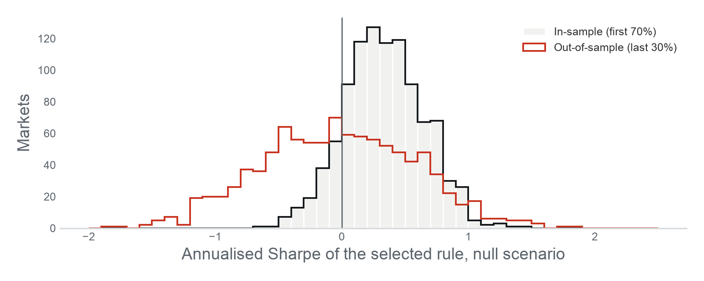
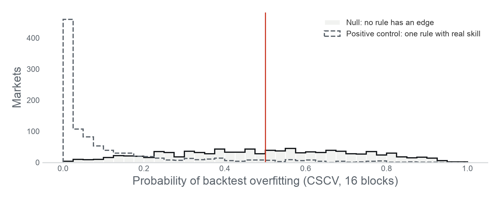

# Selection bias in a moving-average search: PSR, DSR and PBO on 1,000 simulated markets

Sixty moving-average crossovers are run on simulated returns that contain no
exploitable structure, and the best one in-sample is kept. This note measures
how often each test in `quantstats.validity` flags, or fails to flag, the
selected rule, and how the same tests behave when one of the sixty rules has
real predictive power.

Every number below is produced by [`selection-bias/study.py`](selection-bias/study.py).

## Design

**Market.** 2,520 daily returns, `0.008 · t(5) + drift`, independent across
days. Annualised volatility is about 16%.

**Rules.** Long when the fast moving average of the price is above the slow
one, flat otherwise, using the previous day's signal. Fast windows 3, 5, 8, 10,
15, 20; slow windows 30 to 250; 60 rules in total. The median pairwise
correlation between their returns is 0.79.

**Selection.** The rule with the highest Sharpe ratio on the first 70% of the
sample is kept. The last 30% plays no part in the choice.

**Scenarios**, 1,000 markets each:

| Scenario | Drift | What is true |
| --- | --- | --- |
| Null | 0 | Every rule has a true Sharpe of zero. |
| Drift | 3 bp/day | Rules earn part of the market premium while long. None has timing ability. |
| Positive control | 0 | One crossover is replaced by a long/short rule that observes the same day's return through noise. Its true annualised Sharpe is 1.01. |

**Control for selection.** In every market one rule fixed in advance
(`ma_10_40`) goes through the same tests. Any difference between the selected
rule and the fixed rule is the effect of selecting.

## One market

The [sample validity report](https://htmlpreview.github.io/?https://github.com/diegoalvarezmgl/quantstats-pro/blob/main/docs/tearsheet_validity.html)
is a single draw from the drift scenario (seed 3). Buy-and-hold had a Sharpe
of −0.04 on that path. The selected rule, `ma_10_40`, shows:

| | |
| --- | --- |
| Sharpe, in-sample / out-of-sample | 0.74 / −0.45 |
| Sharpe, full sample | 0.41 |
| Probabilistic Sharpe ratio (one trial) | 90.5% |
| Deflated Sharpe ratio (60 trials) | 64.5% |
| Alpha t-statistic (Newey–West) | 1.91 |
| Probability of backtest overfitting | 72.7% |

One path proves nothing about a test. The rest of this note is about rates.

## 1,000 markets

Shares of markets in which each test crosses its conventional threshold.
Monte Carlo standard errors are at most 1.6 percentage points.

| | Nominal | Null, selected | Null, fixed | Drift, selected | Drift, fixed | Positive control, selected |
| --- | ---: | ---: | ---: | ---: | ---: | ---: |
| PSR ≥ 95% (selection ignored) | 5% | 15.8% | 4.6% | 54.4% | 27.0% | 93.4% |
| DSR ≥ 95% | ≤ 5% | 1.2% | – | 18.5% | – | 56.9% |
| Alpha t > 1.96 | 2.5% | 12.6% | 2.8% | 11.1% | 1.5% | 87.8% |
| Alpha t > max-t bootstrap threshold | ≤ 2.5% | 1.5% | – | 1.3% | – | 62.8% |
| Alpha t > Šidák threshold (3.34) | ≤ 2.5% | 0.4% | – | 0.3% | – | 45.9% |
| Sharpe degradation, p < 0.05 | 5% | 14.5% | 5.4% | 11.6% | 5.7% | 9.8% |
| Median PBO | – | 0.51 | – | 0.51 | – | 0.03 |
| PBO ≥ 0.5 | – | 51.1% | – | 50.8% | – | 5.9% |
| PBO < 0.25 | – | 16.3% | – | 16.0% | – | 85.3% |
| PBO ≤ 0.05 | – | 1.4% | – | 1.3% | – | 56.6% |
| Median Sharpe, in-sample | – | 0.32 | 0.00 | 0.64 | 0.33 | 1.04 |
| Median Sharpe, out-of-sample | – | −0.04 | −0.03 | 0.33 | 0.33 | 0.95 |



### What the null scenario shows

**The tests are correctly sized when nothing is selected.** The fixed rule
crosses each threshold at its nominal rate: 4.6%, 2.8% and 5.4% against 5%,
2.5% and 5%. Long/flat returns with many zero days and fat tails do not
distort them.

**Selection triples the false-positive rate of the uncorrected tests.** The
probabilistic Sharpe ratio of the selected rule exceeds 95% in 15.8% of
markets. The in-sample Sharpe of the winner has a median of 0.32 where the
truth is zero.

**The deflated Sharpe ratio removes it, and then some.** DSR tests the observed
Sharpe against the expected maximum of N zero-skill trials, scaled by the
dispersion of Sharpe ratios across the trials actually run (Bailey and López de
Prado, 2014). Here it exceeds 95% in 1.2% of markets, below its 5% ceiling. Selecting on
the full sample instead of the first 70% gives 1.7%, so the margin is not an
artefact of the split: in this design the test is conservative. The median
hurdle is an annualised Sharpe of 0.31.

**The out-of-sample test detects selection, which is its job.** A one-sided
test of the Sharpe falling after the split rejects in 14.5% of markets for the
selected rule and 5.4% for the fixed one. With no true edge, the winner's
out-of-sample Sharpe reverts to zero.

**PBO centres on 0.5 and is widely dispersed.** Under the null the in-sample
winner is equally likely to land in either half of the out-of-sample ranking,
so the median is 0.51. On a single market it ranges over most of the unit
interval: it is below 0.5 in 49% of them and below 0.25 in 16.3%. A PBO near
one half means selection carried no information, but a single PBO somewhat
below one half is weak evidence of the opposite.

**The published rejection level separates the two cases.** Bailey, Borwein,
López de Prado and Zhu (2017) treat PBO as a type I error probability and
reject above 0.05. A no-skill search gets at or under that level in 1.4% of
markets; the positive control does in 56.6%. From version 0.7 the report
follows it: no flag at or below 0.05, a caution worded as inconclusive up to
0.5, a warning from 0.5. Earlier versions stopped flagging below 0.25, a level
that one no-skill search in six reaches.



### The alpha t-statistic is not corrected for selection

The Newey–West t-statistic of alpha exceeds 1.96 in 12.6% of null markets for
the selected rule, against 2.8% for the fixed rule. It is computed on the
chosen series alone, so it inherits the selection effect in full. The 97.5%
quantile of the selected rule's t-statistic under the null is 2.72, not 1.96.

Two corrections are compared, both one-sided at 2.5%:

- **Šidák**, the normal quantile at `0.975^(1/60)`, is 3.34. It assumes 60
  independent tests. Like the Bonferroni and Holm adjustments in Harvey and
  Liu (2015), it ignores the dependence between them. With a median correlation of 0.79 between rules it is
  conservative: 0.4% of null markets cross it, and 45.9% of the positive
  control.
- **A studentised max-t stationary bootstrap**, in the spirit of White (2000)
  and Romano and Wolf (2005). The 60 rules and the market are resampled with
  the same time indices, each replicate's t-statistics are recentred on the
  observed alphas, and the threshold is the 97.5% quantile of the largest one.
  Its median is 2.89. 1.5% of null markets cross it, and 62.8% of the positive
  control. It is still conservative, because it bounds the largest t-statistic
  among all rules while the rule tested was chosen by in-sample Sharpe.

From version 0.7 `validate` reports that threshold as `decay.edge_t_threshold`:
the bootstrap when the returns of every variant are passed, Šidák when only
their number is, 1.96 for a single trial. A t-statistic between 1.96 and the
threshold raises `ALPHA_NOT_SIGNIFICANT_AFTER_SELECTION`. The study uses 500
bootstrap replicates per market; `validate` uses up to 1,000.

### What the drift scenario shows

The deflated Sharpe ratio exceeds 95% in 18.5% of markets, and the fixed rule's
probabilistic Sharpe ratio does so in 27.0%. Neither is a false positive. Both
test the hypothesis that the Sharpe ratio is zero, and here it is not: a rule
that is long part of the time in a market with a Sharpe of 0.46 has a positive
Sharpe of its own. The fixed rule's median is 0.33.

That Sharpe is not timing ability. Against the market the fixed rule's alpha
t-statistic exceeds 1.96 in 1.5% of markets, and the selected rule's clears
the selection-adjusted threshold in 1.3%. For a long-biased strategy the relevant
question is the benchmark-relative one, and a deflated Sharpe ratio computed on
raw returns does not answer it.

### What the positive control shows

The skilled rule is the in-sample winner in 91.4% of markets, and PBO falls to
a median of 0.03: when one rule is really better, combinatorial
cross-validation says so.

The deflated Sharpe ratio exceeds 95% in 56.9% of markets, against 93.4% for
the uncorrected version; conditional on the skilled rule being the one
selected, 60.9%. That gap is the price of the correction with ten years of
daily data, a true Sharpe of 1 and 60 trials. The design makes it larger than
it would otherwise be: the skilled rule is an outlier among the trials, which
raises the cross-trial dispersion, and the median hurdle goes from 0.31 in the
null scenario to 0.46 here. It is also a single rule, so nothing about it
generalises to a family of skilled strategies.

## Limits

- One return process, one rule family, one selection criterion. Rates will
  differ with serial dependence, other rule families or other sample lengths.
- No transaction costs. They would lower every Sharpe ratio here without
  changing the comparison between selected and fixed rules.
- The positive control observes the same day's return by construction. It
  exists to check that the tests can pass something; it is not a strategy.
- None of these tests detects look-ahead bias, survivorship bias or
  unrealistic fills. They address sampling error and selection only.

## Reproduce

From a clone of the repository, with `quantstats-pro` 0.7 or later installed:

```bash
python docs/articles/selection-bias/study.py            # 15 to 20 minutes on 8 cores
python docs/articles/selection-bias/study.py --markets 200
```

Markets are drawn from one generator in sequence, so the results do not depend
on `--workers`.

The script writes `results.json` and both figures next to itself. To run the
same checks on your own search, pass the returns of every variant you tried:

```python
import quantstats as qs

result = qs.reports.html_validity(
    returns,                 # the variant you selected
    benchmark,               # benchmark returns, for alpha
    trials=all_variants,     # DataFrame, one column per variant tried
    split="2022-01-01",      # first date not used for selection
    output="validity.html",
)
print(result.summary())
```

## References

- Bailey, D. H. and López de Prado, M. (2012). The Sharpe ratio efficient frontier. *Journal of Risk*, 15(2).
- Bailey, D. H. and López de Prado, M. (2014). The deflated Sharpe ratio: correcting for selection bias, backtest overfitting and non-normality. *Journal of Portfolio Management*, 40(5).
- Bailey, D. H., Borwein, J. M., López de Prado, M. and Zhu, Q. J. (2017). The probability of backtest overfitting. *Journal of Computational Finance*, 20(4).
- Harvey, C. R. and Liu, Y. (2015). Backtesting. *Journal of Portfolio Management*, Fall 2015.
- Newey, W. K. and West, K. D. (1987). A simple, positive semi-definite, heteroskedasticity and autocorrelation consistent covariance matrix. *Econometrica*, 55(3).
- Romano, J. P. and Wolf, M. (2005). Stepwise multiple testing as formalized data snooping. *Econometrica*, 73(4).
- White, H. (2000). A reality check for data snooping. *Econometrica*, 68(5).
